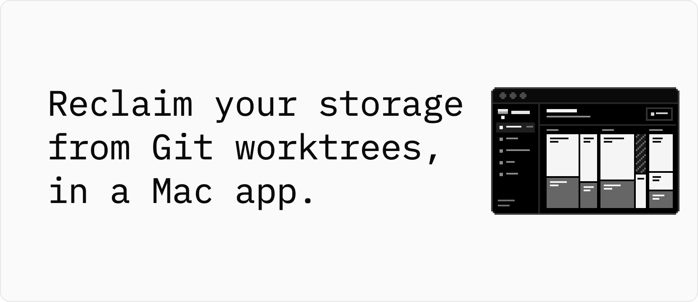
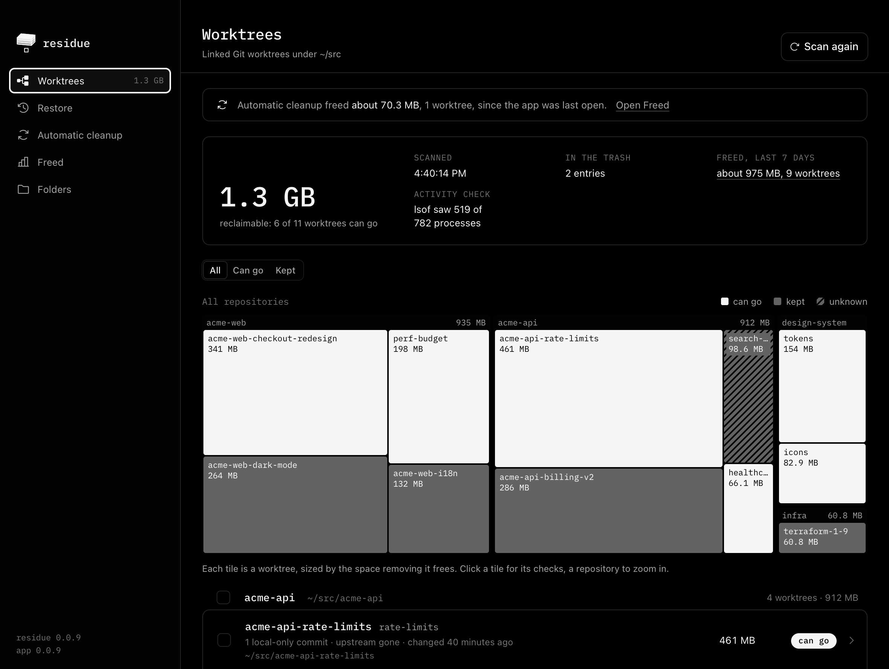
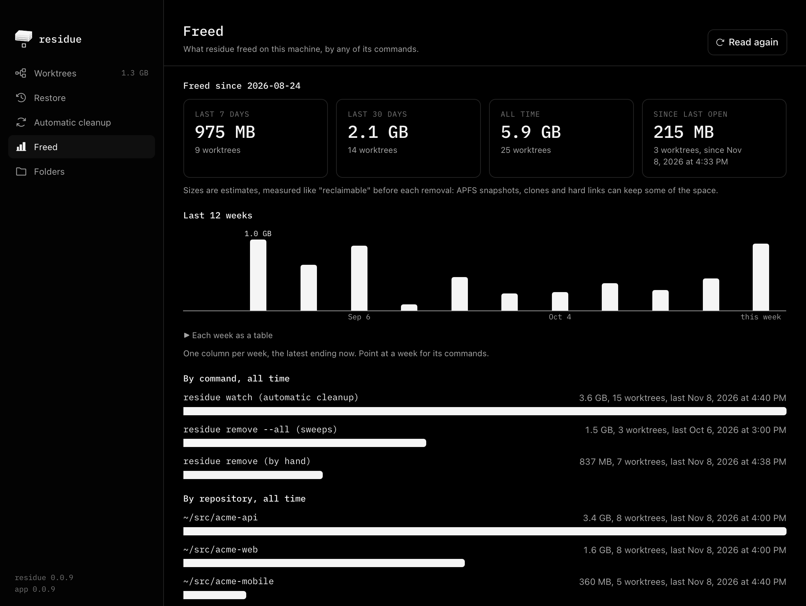

# residue-ui

<p>
<picture>
  <source media="(prefers-color-scheme: dark)" srcset="docs/assets/hero-dark.png">
  <source media="(prefers-color-scheme: light)" srcset="docs/assets/hero.png">
  
</picture>
</p>

**Every check, size and removal in its window comes from the residue CLI, and nothing moves to the trash until you confirm the plan residue shows.**

```sh
curl -fLO https://github.com/whiteheap/residue-ui/releases/latest/download/residue-macos.dmg
open residue-macos.dmg
```

Then drag residue to Applications. It needs macOS 13 or later, on Apple silicon or Intel, and nothing else: residue is inside. It is not notarized yet, so macOS may block the first launch: [First launch](#first-launch) has the steps.

<p>
<picture>
  <source media="(prefers-color-scheme: dark)" srcset="docs/assets/how-it-works-dark.png">
  <source media="(prefers-color-scheme: light)" srcset="docs/assets/how-it-works.png">
  
</picture>
</p>

The app scans the folders you pick, or, until you save some, the usual code folders that exist, such as `~/src`. Worktrees, a worktree's checks, Restore, Automatic cleanup and Freed each show what residue reports, and no read changes a worktree: the window reads at launch, when you open a screen and when you ask, never on a timer. You can select only a worktree that can go, where every check passed. Move to the trash shows residue's plan first, which moves and purges nothing; only when you confirm it does the app run the same command with `--yes` and exactly the planned paths, and residue checks each one again. A trash entry comes back whole, but it frees no disk until a later removal or automatic cleanup purges it into a removal record, from which Restore recreates the worktree without its ignored files. By default, a trash entry lasts at least 7 days and a removal record at least 30. Automatic cleanup is residue's service: once you turn it on, it removes worktrees that can go on its own, when their work landed or the disk is low, and it deletes them instead of using the trash. residue never deletes a branch, commit or stash. The app makes no network request of its own; only `watch` and Preview fetch, from your repositories' remotes.

[Install](#install) · [Screens](#screens) · [What the app runs](#what-the-app-runs) · [Uninstall](#uninstall) · [Build from source](#build-from-source)

## Install

Download [residue-macos.dmg](https://github.com/whiteheap/residue-ui/releases/latest/download/residue-macos.dmg), open it, and drag residue to Applications. The link always serves the latest release. The app is universal, for Apple silicon and Intel, and needs macOS 13 or later.

The app bundles the residue CLI of one [residue-cli](https://github.com/whiteheap/residue-cli) release, and its sidebar shows that version beside its own. You do not need residue installed. Up to 0.0.10, the app shipped in residue-cli's releases.

### First launch

The app is signed ad hoc, not with an Apple Developer ID, and it is not notarized yet. When you download it with a browser, macOS blocks it the first time you open it. To open it once, and from then on like any other app:

1. Open residue from Applications. macOS says it could not verify the app. Click **Done**.
2. Open **System Settings > Privacy & Security**, scroll down to **Security**, and click **Open Anyway** next to the message about residue. The button is there for about an hour after you tried to open the app.
3. macOS asks again: click **Open**, and enter your login password if it asks.

Control-click > Open no longer skips this step: since macOS 15, Apple requires the Privacy & Security setting. Apple's own steps: [Open a Mac app from an unknown developer](https://support.apple.com/guide/mac-help/open-a-mac-app-from-an-unknown-developer-mh40616/mac) and [Safely open apps on your Mac](https://support.apple.com/en-us/102445).

### Check a download

Each release publishes the DMG with `SHA256SUMS` and a build-provenance attestation. In the folder that holds the DMG, with [gh](https://cli.github.com) and the release's tag in place of `vX.Y.Z`:

```sh
gh attestation verify residue-macos.dmg --repo whiteheap/residue-ui --deny-self-hosted-runners \
  --cert-identity https://github.com/whiteheap/residue-ui/.github/workflows/release.yml@refs/tags/vX.Y.Z
```

`--cert-identity` names the workflow and the tag that must have built the DMG: `--repo` alone accepts an attestation from any workflow of the repository, at any branch or tag. Each release's notes give the command with its tag. Or, with the release's `SHA256SUMS` beside it, `shasum -a 256 -c SHA256SUMS`. A DMG from residue-cli's releases, 0.0.10 or earlier, verifies with `whiteheap/residue` in place of `whiteheap/residue-ui`, in both places.

## Screens

Worktrees sizes each worktree by the space removing it frees, and shows what keeps each one. Restore lists what residue can bring back, and Freed what it has freed.

<p>

</p>

<p>

</p>

<p>

</p>

The screenshots show example repositories and a made-up history of removals.

## What the app runs

- **Worktrees** is `residue scan --json` on your folders, and a worktree's checks are `residue explain --json`. A worktree **can go** (residue's `candidate`) only when every check passed. It is **kept** (`keep`) when a check blocked, **unknown** when one could not finish, and **stale** when Git lists it but its directory is missing or does not match: [What makes a worktree a candidate](https://github.com/whiteheap/residue-cli#what-makes-a-worktree-a-candidate).
- **Removal** always uses the trash (`residue remove --trash`), and nothing moves until you confirm the plan residue shows: the worktrees it moves, the trash entries older than 7 days it purges, and the removal records it forgets, each older than both 30 days and the `--keep-removed` it was written with. The confirmed run adds `--yes` and `--as-of` the plan's time, with exactly the planned paths, so it purges and forgets only what the plan listed. The branch and its commits always stay. A trash entry frees no disk until it is purged, and its branch stays checked out there, so `git switch` to that branch in another worktree refuses until you restore it or the purge removes it: [The trash](https://github.com/whiteheap/residue-cli#the-trash).
- **Restore** is `residue restore`, and it lists the trash and the removal records, newest first. A trashed worktree comes back with every file until a later removal or automatic cleanup in that repository purges it. The purge, and every deletion by automatic cleanup, leaves a removal record, and Restore recreates the worktree from it until a later removal forgets the record: on its branch and HEAD, or on a new branch at that HEAD when its branch no longer contains it or is checked out elsewhere. No run forgets one before the `--keep-removed` it was written with: 30 days for the app's removals, the service's for automatic cleanup. Each record's row gives the date it lasts until, at least. Its ignored files, such as `node_modules/`, do not come back, and the record's row names them before you click: [Restore a removed worktree](https://github.com/whiteheap/residue-cli#restore-a-removed-worktree).
- **Freed** is `residue stats --json`: what residue freed on this machine in the last 7 and 30 days, all time and since the app was last open, each of the last 12 weeks, by command and by repository. When automatic cleanup freed space while the app was closed, the Worktrees screen opens with how much. Each size is the estimate residue measured before the removal: [How much space it freed](https://github.com/whiteheap/residue-cli#how-much-space-it-freed).
- **Automatic cleanup** is `residue service install FOLDERS` and `residue service uninstall`: the same `com.whiteheap.residue.watch` service as residue's [Automate cleanup](https://github.com/whiteheap/residue-cli#automate-cleanup), so the app shows a service you installed from a terminal, and the other way round. It deletes instead of using the trash; the app says so before you turn it on. Saving other folders keeps the service's options as written, including ones the app does not know. Preview runs one pass the way the saved service would, with `--dry-run`, fetching first unless the service sets `--no-fetch`.
- The service records the binary that installed it, so the app never installs it from the copy inside the app. It uses a `residue` you installed that is at least as new as the app's, such as `/opt/homebrew/bin/residue`, or else a copy at `~/Library/Application Support/com.whiteheap.residue/bin/residue`, which stays when the app moves or is deleted. The Automatic cleanup screen shows which binary the service runs and the command that turns it off from a terminal. Deleting the app leaves the service running.

## Uninstall

Turn off automatic cleanup first, in **Automatic cleanup**: deleting the app leaves the service running. Then drag residue from Applications to the Trash.

The app's settings, and the service's copy of residue if it had one, stay in `~/Library/Application Support/com.whiteheap.residue/`. residue's own records stay too, since the residue CLI reads them: its ledger in `~/Library/Application Support/residue/`, and each repository's trash entries and removal records in its Git directory. A trash entry keeps its space until a later `residue remove` in that repository purges it.

## Where it fits

The app is residue in a window, on a Mac. It does not create worktrees and it does not merge branches.

| Tool | Use it when |
| --- | --- |
| residue-ui | You want to see the worktrees under your code folders and what keeps each one, and move the ones that can go to the trash with a click |
| [residue](https://github.com/whiteheap/residue-cli) | You work in a terminal, on Linux or another Unix, or from a script or an agent's last step |

For tools that create and remove worktrees themselves, such as Claude Code and Worktrunk, see [Where it fits](https://github.com/whiteheap/residue-cli#where-it-fits) in residue's README.

## Build from source

You need macOS 13 or later with Xcode's command line tools, rustup, Node 22.12 or later, and pnpm.

```sh
git clone https://github.com/whiteheap/residue-ui
cd residue-ui
pnpm install --frozen-lockfile
pnpm tauri dev
```

`pnpm tauri dev` places the residue-cli release that `sidecar.lock` pins, checked by its sha256 and, with gh logged in, its attestation, then opens a debug build. The app is Tauri 2: Rust in `src-tauri/`, React and TypeScript in `src/`. [CONTRIBUTING.md](CONTRIBUTING.md) has the release build, the checks, and how to try a residue from your own checkout. [AGENTS.md](AGENTS.md) has the app's invariants. The app's whole history is here: its first commits, then those made in residue-cli's `app/` folder, merged in [#3](https://github.com/whiteheap/residue-ui/pull/3) and [#7](https://github.com/whiteheap/residue-ui/pull/7).

## Security

[SECURITY.md](SECURITY.md) says how to report a security issue privately.

## License

MIT, in [LICENSE](LICENSE).
